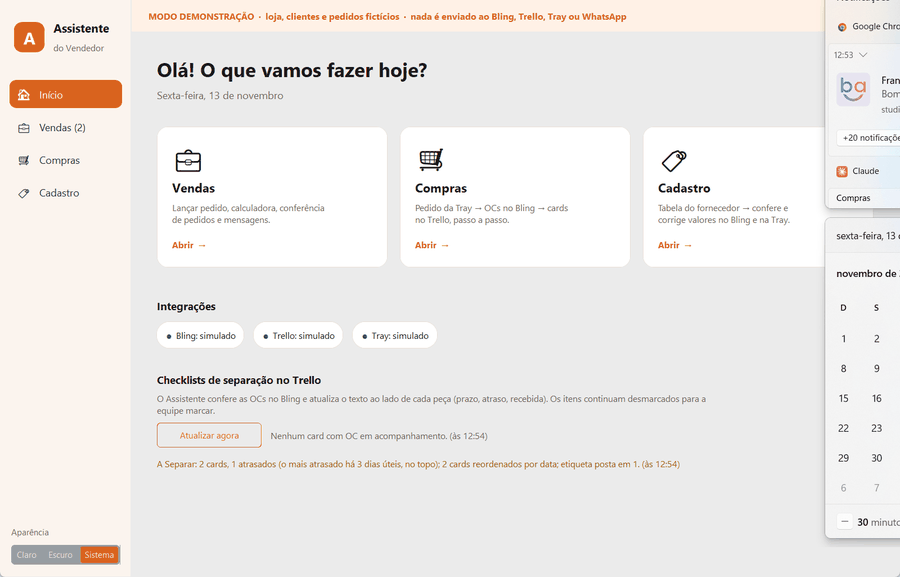
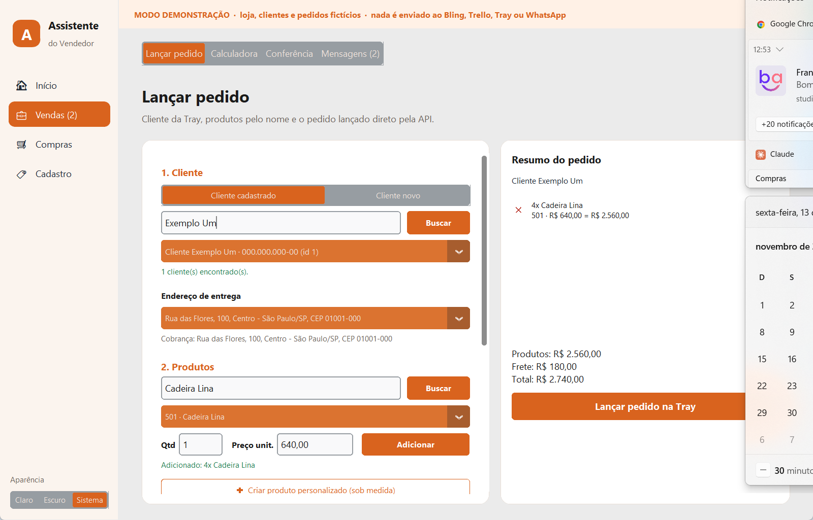
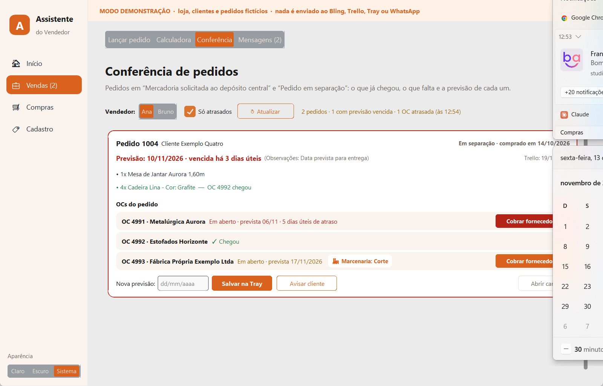
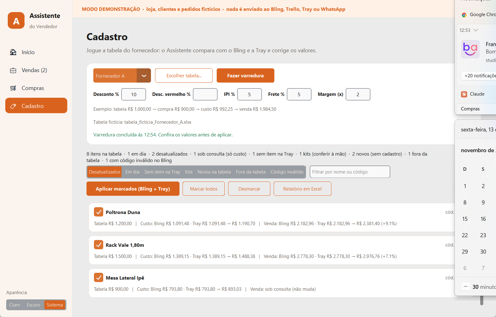
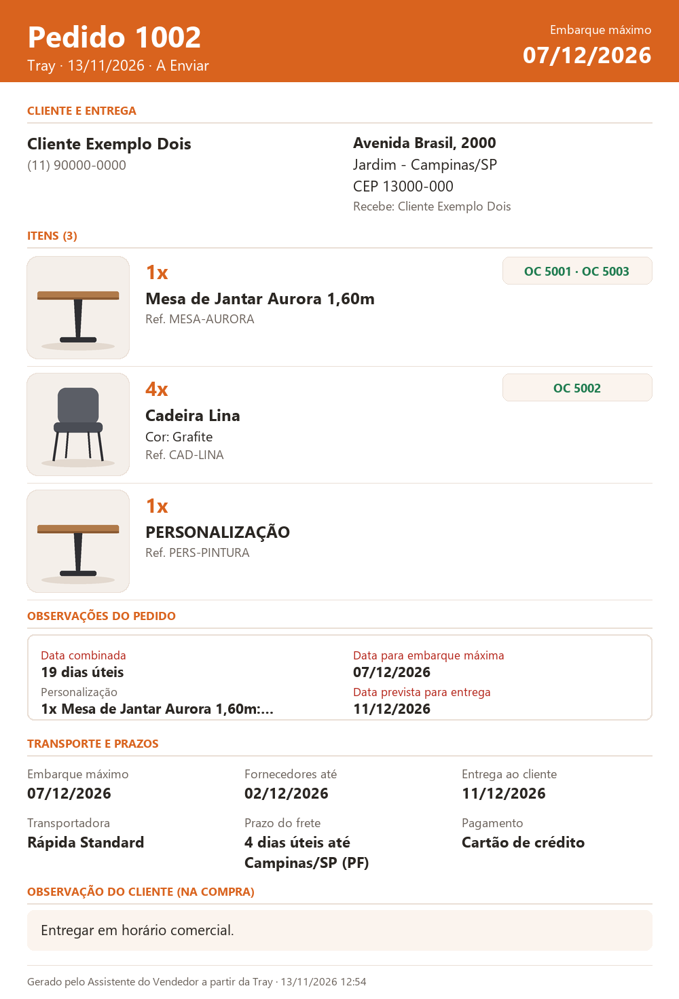
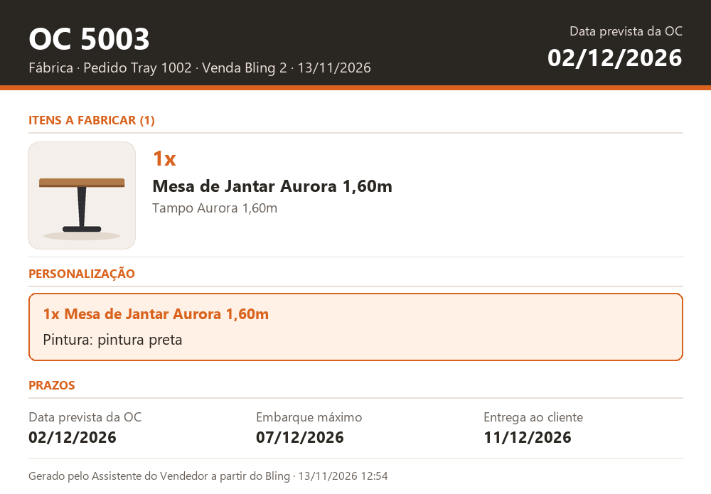

# Assistente do Vendedor

Aplicativo de desktop (Windows) que centraliza a rotina de uma loja de móveis on-line em três módulos:
**Vendas**, **Compras** e **Cadastro**. Liga a loja (**Tray**), o ERP (**Bling**), o quadro de produção
(**Trello**) e o **WhatsApp**, perguntando ao vendedor só o que exige decisão.

> ✅ **Projeto concluído** (novembro de 2026): em uso diário na loja, com os três módulos em produção.
>
> **Projeto de portfólio.** Todos os dados deste repositório são fictícios. A versão de demonstração não
> acessa nenhuma plataforma: Bling, Trello, Tray e WhatsApp são simulados dentro do programa.

📄 **Explicação visual dos processos:** [abrir a página](https://nagurnhak.github.io/assistente_do_vendedor/)



---

## O problema

Cada venda passava por quatro ferramentas, à mão: lançar o pedido na loja, descobrir o fornecedor de cada item,
emitir uma ordem de compra por fornecedor, calcular prazos, abrir cards para a fábrica e a logística e cobrar quem
estava atrasado. Além disso, cada tabela nova de fornecedor deixava custos e preços do site desatualizados, e achar
as diferenças produto por produto era lento e fácil de errar.

## O resultado

- **Medido:** em 1 semana de uso pelos vendedores, o tempo gasto com compras caiu **80%**.
- **Com a integração da Tray:** cada pedido passou de **5 minutos para 30 segundos** (10 vezes mais rápido) conforme o projetado.
- **Módulo Cadastro:** mais de **1.500 atualizações de custo e preço** gravadas e registradas em histórico nos
  3 primeiros dias de uso.

## Os três módulos

| Módulo | Telas | Para quê |
|---|---|---|
| 💼 **Vendas** | Lançar pedido · Calculadora · Conferência · Mensagens | Colocar o pedido na loja e acompanhar o que está atrasado |
| 🛒 **Compras** | Fluxo de compras · Descrição HTML | Do pedido da Tray às OCs no Bling e aos cards no Trello |
| 🏷️ **Cadastro** | Varredura de tabelas | Comparar a tabela do fornecedor com o sistema e corrigir os valores |

### 💼 Vendas: Lançar pedido



Cadastra o pedido direto na Tray pela API, sem abrir o painel da loja.

- **Cliente:** busca por CPF/CNPJ, nome ou e-mail. Cliente novo: cola a mensagem do WhatsApp e o programa separa
  os campos, completa o endereço pelo CEP e os dados da empresa pelo CNPJ; não cadastra duplicado.
- **Produtos:** busca pelo nome no Bling e na Tray, com variações e preço da Tray. Item sob medida vira um produto
  novo na hora.
- **Conferência automática:** depois de lançar, relê o pedido e confere a entrega. Se a Tray tiver trocado o endereço
  principal do cadastro do cliente, devolve o original e avisa.

### 💼 Vendas: Conferência



Mostra os pedidos de cada vendedor do mais urgente para o mais folgado. O filtro **Só atrasados** deixa na tela os
pedidos com previsão vencida ou com alguma OC atrasada, para resolver um a um.

- **Situação de cada OC:** chegou, em aberto ou atrasada (em dias úteis), e a etapa da fábrica pela lista do card no Trello.
- **Previsão:** vem das observações do pedido, do Trello ou da Tray, nessa ordem.
- **Resolver na hora:** cobrar o fornecedor pelo WhatsApp, salvar a nova previsão no pedido e abrir a mensagem pronta
  para avisar o cliente.

### 🏷️ Cadastro: varredura de tabelas



O usuário escolhe o fornecedor e a tabela em Excel. O programa calcula os valores e cruza com o Bling e a Tray:

`compra = tabela − desconto` → `custo = compra + IPI + frete` → `venda = custo × margem`

| Filtro | O que traz | O que dá para fazer |
|---|---|---|
| Desatualizados | Custo ou preço do site diferente do calculado | **Aplicar em massa** no Bling e na Tray |
| Em dia | Valores que já batem | Nada a fazer |
| Sem item na Tray | Está no Bling, mas não na loja | Conferir o cadastro |
| Kits | Produto estruturado, com custo pelos componentes | Conferir à mão (nunca aplica sozinho) |
| Novos na tabela | **Não consta no sistema**, já com custo e venda calculados | Filtrar e exportar para o Excel |
| Fora da tabela | Saiu da tabela: provável saída de linha | **Inativar em massa** no Bling e na Tray (nada é apagado) |
| Código inválido | Código no Bling que não parece do fornecedor | Corrigir o código no Bling |

Cuidados na hora de gravar: produto **sob consulta** só muda o custo, para o preço não aparecer no site; **preço em
vermelho** na tabela usa o desconto promocional; o produto principal acompanha a menor variação; depois de aplicar,
o programa relê o Bling, regrava o que não ficou e guarda os valores de antes e depois em um histórico.

**Kits da loja:** `py src/sincronizar_kits.py` compara o preço de cada variação dentro dos kits da Tray com o preço
atual (inclusive promoção vigente e desconto do kit) e mostra o que está diferente; com `--gravar`, corrige e guarda
uma cópia de cada kit antes, para poder desfazer.

### 🛒 Compras

1. **Mostra o que precisa ser comprado.** A tela abre com os pedidos da Tray que esperam compra, em cards: vermelho
   para quem espera há mais de 1 dia útil, âmbar para quem já tem OC ou card.
2. **Calcula os prazos pelo frete real.** Lê o endereço do cliente, consulta a tabela da transportadora
   (por cidade ou faixa de CEP) e define a **data máxima de embarque** e a data em que os fornecedores
   precisam entregar.
3. **Emite as ordens de compra.** Desmembra produtos estruturados em componentes, agrupa uma OC por
   fornecedor, identifica os produtos de personalização do pedido e confere cada OC depois de criada.
4. **Abre os cards no Trello.** Card da logística na data máxima de embarque, com a **ficha do pedido** e uma
   checklist de separação; um card por OC da fábrica, com a **ficha da OC**. As fichas substituem os prints manuais.
5. **Atualiza Bling e Tray.** Status do pedido nos dois sistemas e as OCs anotadas nas observações, num bloco
   próprio que não apaga o que outras pessoas escreveram.
6. **Acompanha até a entrega.** De hora em hora confere as OCs no Bling, atualiza as checklists, ordena os cards por
   data com o mais atrasado no topo e monta as **mensagens do dia** pelo WhatsApp.

### Como ficam os cards no Trello

Exemplo gerado pela demonstração com o pedido fictício 1002 (`py docs/gerar_exemplos.py`; título, data e
checklist de cada card em [`docs/exemplos/cards.md`](docs/exemplos/cards.md)):

| Card da logística: ficha do pedido | Card da fábrica: ficha da OC |
|---|---|
|  |  |

### 💬 Mensagens

Lembretes do dia a fornecedores, fábrica e logística, com envio pelo WhatsApp Web. As respostas são lidas e ligadas à
OC ou ao pedido pela referência da mensagem (`#OC5001`, `#P1002`); a nova data só é aplicada depois do clique de quem
confere. A tela também tem o histórico de envios, exportável para Excel.

## Regras de negócio

| Regra | Como funciona |
|---|---|
| Dias úteis | Pula fins de semana e feriados nacionais (inclusive Carnaval, Sexta-feira Santa e Corpus Christi), mais os feriados locais do `config.json`. |
| Prazos | Contados da data da compra: entrega = compra + prazo combinado; **embarque máximo** = entrega − frete da tabela; fornecedores = embarque − 3 dias úteis de logística. |
| Sem tabela de frete | Vale a regra anterior: card da logística = prazo combinado − 10 dias úteis. |
| Retirada no depósito | Sem transportadora nem frete: a data de retirada é a própria entrega, e o card avisa que o cliente retira. |
| Pedido no Bling | Só aceita a venda cujo número da loja é o da Tray; com mais de uma, pergunta qual. Venda lançada sem o número só vale se as observações citarem o pedido da Tray. |
| Atraso | Prazo estourado aparece como **ATRASADO** no título dos cards e nas fichas. |
| Ordens de compra | Cada OC lista só os itens que ela compra; a OC da fábrica sempre mostra item + personalização. |
| Lembretes aos fornecedores | 14 e 7 dias úteis antes da data da OC, no dia e uma cobrança por dia útil em atraso, até a OC ser recebida. |
| Lembretes à logística | 2 dias úteis antes da data máxima de embarque, no dia e uma cobrança por dia útil enquanto o card estiver na lista de separação. |
| Listas do Trello | Cards em ordem de data, o mais atrasado no topo, com etiqueta vermelha de atraso. |
| Previsão do pedido | A última "Nova previsão" escrita nas observações manda; depois, a data do card e a da Tray. |
| Casamento de códigos | Só aplica preço quando o código bate com segurança; código ambíguo vai para conferência em vez de ganhar um preço por palpite. |
| Falha no meio | O programa avisa o que **já foi criado**, para ninguém duplicar OC ou card. |

## Como testar (sem conta em nenhuma plataforma)

**Executável:** baixe o `Assistente_do_Vendedor_DEMO.exe` na aba *Releases* e abra.

Se o Windows mostrar ‘O Windows protegeu o computador’, clique em Mais informações → Executar assim mesmo: o aviso aparece porque o executável não tem assinatura digital.

**Pelo código:**

```bash
py -m pip install customtkinter pillow requests openpyxl
py src/app_demo.py
```

Na demonstração:
- **Vendas › Lançar pedido:** busque "Exemplo Um" ou "Empresa Exemplo" e produtos como "Cadeira Lina".
- **Vendas › Conferência:** escolha **Ana** ou **Bruno** e marque **Só atrasados**.
- **Compras:** pedidos **1001** (em estoque, frete local), **1002** (mesa estruturada + cadeiras + personalização,
  frete pela tabela) e **1003** (retirada no depósito, sem frete). Ao terminar, a janela **Cards criados** mostra os cards como
  ficariam no Trello.
- **Cadastro:** **Fornecedor A** e **Fornecedor B** já vêm com uma tabela fictícia. Clique em **Fazer varredura**.

**Testes automáticos** (47 testes; os da demonstração rodam com a internet *bloqueada*):

```bash
py -m unittest discover testes
```

`py docs/gerar_prints.py` abre a janela de verdade, percorre os módulos, gera os prints e falha se alguma tela der erro.

## Arquitetura

```
src/
  app.py                    janela: lateral dos módulos, abas, tarefas em segundo plano e envios
  interface.py              cores, fontes e componentes comuns das telas
  telas_vendas.py           telas Lançar pedido, Calculadora, Conferência e Mensagens
  telas_compras.py          telas do fluxo de compras e da Descrição HTML
  telas_cadastro.py         tela da varredura de tabelas
  lancar_pedido.py          clientes, produtos e lançamento do pedido na Tray
  conferencia.py            pedidos por vendedor, situação das OCs, previsão e cobrança
  cadastro.py               leitura das tabelas, varredura, aplicação em massa, inativação e relatório
  sincronizar_kits.py       confere e corrige o preço das variações dentro dos kits da Tray (linha de comando)
  ferramentas_internas.py   regras de negócio e fluxo de compras (também roda no terminal)
  BLING.py                  API v3 do Bling: OAuth2, renovação de token, limite de requisições
  TRAY.py                   API da Tray: autenticação, limites de uso, pedidos, observações e status
  fichas.py                 fichas em imagem (PNG) do pedido e da OC, anexadas aos cards
  prazos_frete.py           tabelas de frete das transportadoras (Excel -> JSON) e cálculo do prazo
  notas_compras.py          bloco gerenciado nas observações do pedido (preserva o resto do texto)
  WHATSAPP.py               envio e leitura de respostas pelo WhatsApp Web (Playwright), com modo teste e limite diário
  demo.py                   Bling, Trello, Tray e WhatsApp simulados, com dados, tabelas e fotos fictícios
  app_demo.py               abre a janela já em modo demonstração
  configuracao.py           leitura do config.json
testes/                     testes automáticos (unittest)
docs/index.html             explicação visual dos processos
docs/gerar_prints.py        percorre a janela real e gera os prints e o GIF
docs/gerar_exemplos.py      gera as fichas e os cards de exemplo
```

O fluxo de compras usa `print()`/`input()`, então funciona no terminal e na janela: a janela troca essas duas funções
por um painel que mostra uma pergunta por vez, com botões para as escolhas.

## Segurança

- Nenhuma credencial no código: chaves ficam num `config.json` local, fora do Git (`.gitignore`).
  O modelo está em [`src/config.exemplo.json`](src/config.exemplo.json).
- **Condições comerciais fora do código:** descontos, margens, vendedores e fornecedores reais ficam no `config.json`;
  os perfis do repositório são exemplos fictícios.
- Tokens gravados de forma atômica (arquivo temporário + troca), para não corromper se o programa fechar.
- Chave e token do Trello vão no cabeçalho, não na URL; o módulo da Tray apaga segredos das mensagens de erro.
- Antes de gravar observações na Tray, o programa relê o pedido e só grava se ninguém mudou o texto no meio;
  ao criar uma OC, relê e confere o fornecedor antes de seguir.
- Ações em massa só valem para o que foi marcado, com confirmação; a varredura começa com tudo desmarcado.
- O WhatsApp começa em **modo teste**: as mensagens vão para números de teste até a liberação.
- Dados de trabalho (pedidos acompanhados, mensagens, históricos, tabelas, sessão do WhatsApp) ficam só
  no computador e estão no `.gitignore`; na demonstração vão para uma pasta temporária.
- O executável de demonstração é gerado **sem** os módulos `BLING.py`, `TRAY.py` e `WHATSAPP.py`.

## Uso real

1. Copie `src/config.exemplo.json` para `src/config.json` e preencha as credenciais, as listas do Trello, os
   vendedores, os perfis de fornecedor e as transportadoras (colunas de cada planilha de frete).
2. Converta as tabelas de frete: `py src/prazos_frete.py`.
3. Rode `py src/app.py` (ou gere o executável com `gerar_exe.bat`).

## Status

**Concluído.** Os três módulos (Vendas, Compras e Cadastro), a régua de mensagens a fornecedores, fábrica e
logística e a demonstração estão prontos e testados. O repositório fica como referência; ideias que ficaram de fora:

- Cadastrar em massa, direto da tela, os itens de **Novos na tabela** (hoje eles saem calculados no Excel).
- Levar o fluxo para um servidor central, para funcionar com o computador desligado.

## Tecnologias

Python 3 · customtkinter · requests · Pillow · openpyxl · Playwright · PyInstaller · APIs REST (Bling v3, Trello, Tray)

## Licença

[MIT](LICENSE): pode usar, copiar e modificar, desde que mantenha o aviso de copyright.
