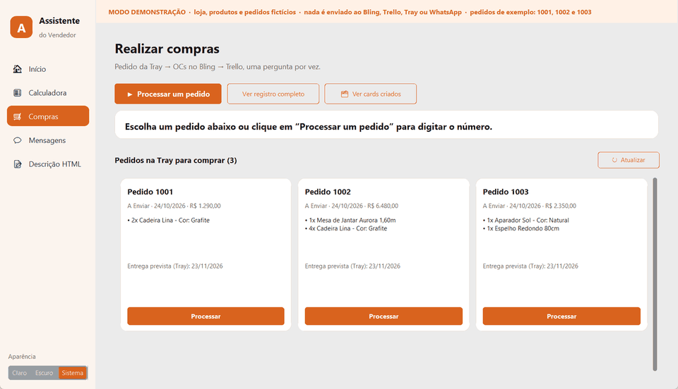
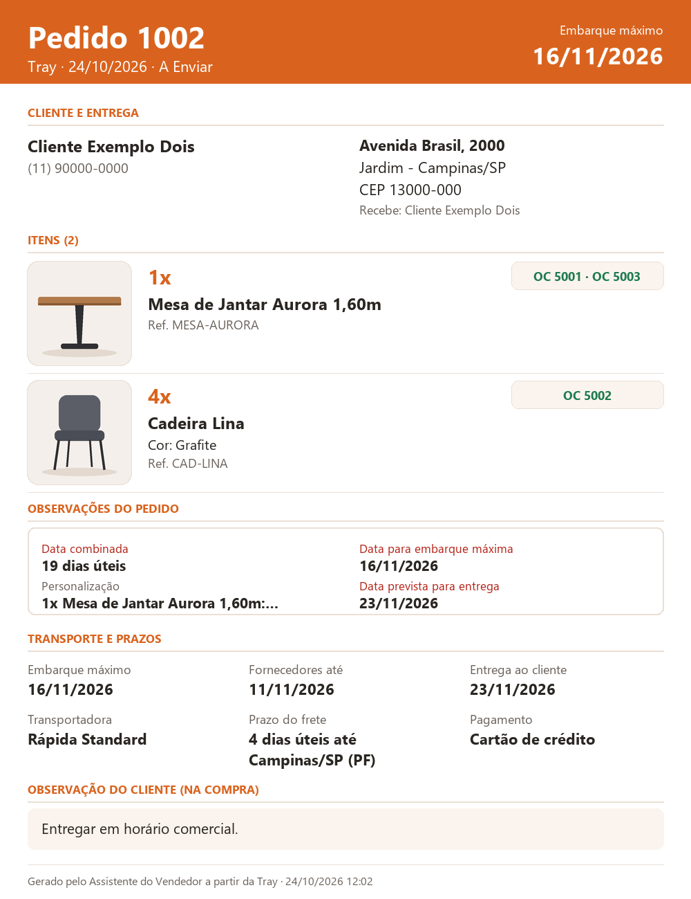
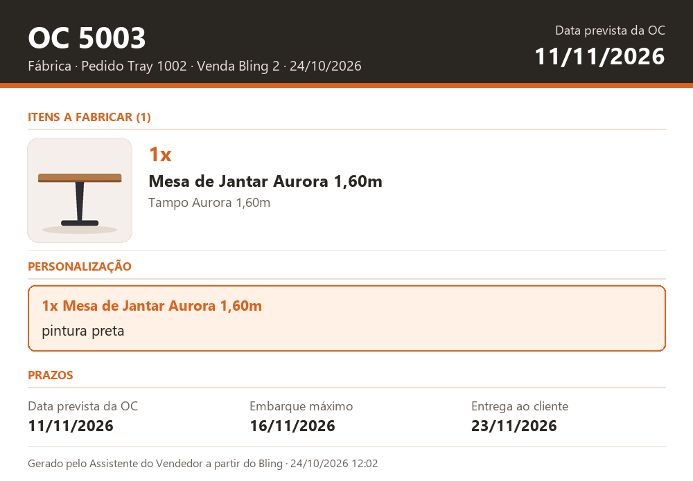

# Assistente do Vendedor

Aplicativo de desktop (Windows) que automatiza a rotina de compras de uma loja de móveis on-line:
do pedido que chega pela **Tray** às ordens de compra no **Bling**, aos cards de produção e logística no
**Trello** e aos lembretes de prazo pelo **WhatsApp**, perguntando ao vendedor só o que exige decisão.

> **Projeto de portfólio.** Todos os dados deste repositório são fictícios. A versão de demonstração não
> acessa nenhuma plataforma: Bling, Trello, Tray e WhatsApp são simulados dentro do programa.


📄 **Explicação visual dos processos:** [abrir a página](https://nagurnhak.github.io/assistente_do_vendedor/)




---

## O problema

Cada venda exigia vários passos manuais entre quatro ferramentas: conferir o pedido, descobrir o fornecedor
de cada item (inclusive das peças de produtos montados, como mesa = tampo + base), emitir uma ordem de compra
por fornecedor, calcular prazos, abrir cards para a fábrica e a logística com prints, atualizar o status do
pedido e, depois, cobrar fornecedores e logística para nada atrasar. Era lento e fácil de errar.

## O resultado

- **Medido:** em 1 semana de uso pelos vendedores, o tempo gasto com compras caiu **80%**.
- **Com a integração da Tray:** cada pedido passou de **5 minutos para 30 segundos** (10 vezes mais rápido) conforme o projetado.

## O que o assistente faz

1. **Mostra o que precisa ser comprado.** A tela de compras abre com os pedidos da Tray que esperam compra,
   em cards: vermelho para quem espera há mais de 1 dia útil, âmbar para quem já tem OC ou card.
2. **Calcula os prazos pelo frete real.** Lê o endereço do cliente, consulta a tabela da transportadora
   (por cidade ou faixa de CEP) e define a **data máxima de embarque** e a data em que os fornecedores
   precisam entregar.
3. **Emite as ordens de compra.** Desmembra produtos estruturados em componentes, agrupa uma OC por
   fornecedor, manda personalizações para a OC da fábrica e confere cada OC depois de criada.
4. **Abre os cards no Trello.** Card da logística na data máxima de embarque, com a **ficha do pedido** e uma
   checklist de separação; um card por OC da fábrica, com a **ficha da OC**. As fichas substituem os prints manuais.
5. **Atualiza Bling e Tray.** Status do pedido nos dois sistemas e as OCs anotadas nas observações, num bloco
   próprio que não apaga o que outras pessoas escreveram.
6. **Acompanha até a entrega.** De hora em hora confere as OCs no Bling, atualiza as checklists, sobe para o
   topo os cards parados e monta as **mensagens do dia** pelo WhatsApp.

Também tem uma **calculadora de descontos** (12x, 3x e à vista no Pix, com números no formato brasileiro) e um
**gerador da descrição em HTML** do pedido.

### Como ficam os cards no Trello

Exemplo gerado pela demonstração com o pedido fictício 1002 (`py docs/gerar_exemplos.py`; título, data e
checklist de cada card em [`docs/exemplos/cards.md`](docs/exemplos/cards.md)):

| Card da logística: ficha do pedido | Card da fábrica: ficha da OC |
|---|---|
|  |  |

## Regras de negócio

| Regra | Como funciona |
|---|---|
| Dias úteis | Pula fins de semana e feriados nacionais (inclusive Carnaval, Sexta-feira Santa e Corpus Christi), mais os feriados locais do `config.json`. |
| Prazos | Contados da data da compra: entrega = compra + prazo combinado; **embarque máximo** = entrega − frete da tabela; fornecedores = embarque − 3 dias úteis de logística. |
| Sem tabela de frete | Vale a regra anterior: card da logística = prazo combinado − 10 dias úteis. |
| Atraso | Prazo estourado aparece como **ATRASADO** no título dos cards e nas fichas. |
| Ordens de compra | Cada OC lista só os itens que ela compra; a OC da fábrica sempre mostra item + personalização. |
| Lembretes aos fornecedores | 14 e 7 dias úteis antes da data da OC, no dia e uma cobrança por dia útil em atraso, até a OC ser recebida. |
| Lembretes à logística | 2 dias úteis antes da data máxima de embarque, no dia e uma cobrança por dia útil enquanto o card estiver na lista de separação. |
| Lista de separação | Cards parados há mais de 2 dias úteis sobem para o topo e ganham etiqueta. |
| Falha no meio | O programa avisa o que **já foi criado**, para ninguém duplicar OC ou card. |

## Como testar (sem conta em nenhuma plataforma)

**Executável:** baixe o `Assistente_do_Vendedor_DEMO.exe` na aba *Releases* e abra.

Se o Windows mostrar ‘O Windows protegeu o computador’, clique em Mais informações → Executar assim mesmo: o aviso aparece porque o executável não tem assinatura digital.

**Pelo código:**

```bash
py -m pip install customtkinter pillow requests
py src/app_demo.py
```

Na demonstração:
- pedidos **1001** (em estoque, frete local), **1002** (mesa estruturada + cadeiras, frete pela tabela) e
  **1003** (personalização, destino sem tabela);
- ao terminar um pedido, abre a janela **Cards criados**, com os cards como ficariam no Trello (lista, data,
  checklist e a ficha anexada); o botão **Ver cards criados** reabre a janela;
- a lista de separação já começa com dois cards fictícios, para mostrar os cards parados e os lembretes à
  logística na tela **Mensagens** (em dias úteis).

**Testes automáticos** (21 testes; os de demonstração rodam com a internet *bloqueada*):

```bash
py -m unittest discover testes
```

## Arquitetura

```
src/
  app.py                    janela (customtkinter): telas, cards de pedidos e o painel de perguntas
  ferramentas_internas.py   regras de negócio e fluxo de compras (também roda no terminal)
  BLING.py                  API v3 do Bling: OAuth2, renovação de token, limite de requisições
  TRAY.py                   API da Tray: autenticação, limites de uso, pedidos, observações e status
  fichas.py                 fichas em imagem (PNG) do pedido e da OC, anexadas aos cards
  prazos_frete.py           tabelas de frete das transportadoras (Excel -> JSON) e cálculo do prazo
  notas_compras.py          bloco gerenciado nas observações do pedido (preserva o resto do texto)
  WHATSAPP.py               envio pelo WhatsApp Web (Playwright), com modo teste e limite diário
  demo.py                   Bling, Trello, Tray e WhatsApp simulados, com dados e fotos fictícios
  app_demo.py               abre a janela já em modo demonstração
  configuracao.py           leitura do config.json
testes/                     testes automáticos (unittest)
docs/index.html             explicação visual dos processos
docs/exemplos/              prints, fichas e cards de exemplo (fichas geradas por docs/gerar_exemplos.py)
```

O fluxo usa `print()`/`input()`, então funciona no terminal e na janela: a janela troca essas duas funções
por um painel que mostra uma pergunta por vez, com botões para as escolhas.

## Segurança

- Nenhuma credencial no código: chaves ficam num `config.json` local, fora do Git (`.gitignore`).
  O modelo está em [`src/config.exemplo.json`](src/config.exemplo.json).
- Tokens gravados de forma atômica (arquivo temporário + troca), para não corromper se o programa fechar.
- Chave e token do Trello vão no cabeçalho, não na URL; o módulo da Tray apaga segredos das mensagens de erro.
- Antes de gravar observações na Tray, o programa relê o pedido e só grava se ninguém mudou o texto no meio;
  ao criar uma OC, relê e confere o fornecedor antes de seguir.
- O WhatsApp começa em **modo teste**: as mensagens vão para números de teste até a liberação.
- Dados de trabalho (pedidos acompanhados, mensagens, histórico, tabelas de frete, sessão do WhatsApp) ficam só
  no computador e estão no `.gitignore`; na demonstração vão para uma pasta temporária.
- O executável de demonstração é gerado **sem** os módulos `BLING.py`, `TRAY.py` e `WHATSAPP.py`.

## Uso real

1. Copie `src/config.exemplo.json` para `src/config.json` e preencha as credenciais, as listas do Trello e as
   transportadoras (colunas de cada planilha de frete).
2. Converta as tabelas de frete: `py src/prazos_frete.py`.
3. Rode `py src/app.py` (ou gere o executável com `gerar_exe.bat`).

## Próximos passos

- Levar o fluxo para um servidor central, para funcionar com o computador desligado.
- Quadro de acompanhamento de vendas por vendedor, com alertas de prazo.

## Tecnologias

Python 3 · customtkinter · requests · Pillow · Playwright · PyInstaller · APIs REST (Bling v3, Trello, Tray)

## Licença

[MIT](LICENSE): pode usar, copiar e modificar, desde que mantenha o aviso de copyright.
